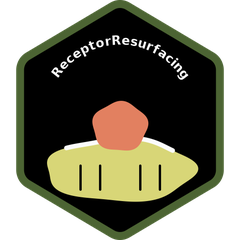

# Receptor Resurfacing Pipeline 

[](https://github.com/joshuandwilliams/receptor-resurfacing-pipeline/actions/workflows/test.yml)
[](https://github.com/joshuandwilliams/receptor-resurfacing-pipeline/actions/workflows/lint.yml)
[](https://app.codecov.io/gh/joshuandwilliams/receptor-resurfacing-pipeline)


A Nextflow DSL2 pipeline for *de novo* binder design. It takes a docked
receptor–effector complex and redesigns the receptor surface around the
effector pose. The output is candidate binder sequences with quality metrics
from several orthogonal validators.

Negative steering of the Boltz-2 predictions is a separate repository,
[structure-negative-steering](https://github.com/joshuandwilliams/structure-negative-steering),
installed once per site and called as a tool.

## Status

Test coverage over `bin/` is **10.81%**, gated as a ratchet in `pyproject.toml`
so it can only go up. Coverage is low because most of `bin/` is reached only
by the `check_test_run` tier. That tier requires a completed pipeline run, so
it cannot contribute to a laptop or CI figure. Raising it is tracked in
[`notes/upstream_parity_plan.md`](notes/upstream_parity_plan.md).

All work is on `main`. It is the only branch. The `phase4-impl` and
`remediation` branches were deleted once every one of their commits was on
`main`.

[`notes/codebase_remediation_plan.md`](notes/codebase_remediation_plan.md)
plans the remediation this codebase is going through.
[`notes/upstream_parity_plan.md`](notes/upstream_parity_plan.md) covers the
work to bring it in line with the engine repository.
[`notes/things_to_fix.md`](notes/things_to_fix.md) lists the known defects
that would change results.

`notes/SESSION_HANDOFF.md` and `notes/remediation_state.md` are per-session
working documents rather than orientation. Both were last written in May 2026
and describe an in-flight run, so read them for history, not for current
state.

## What the pipeline does

The input is PDB only. Branch B takes a single pre-docked complex PDB
(receptor + effector already positioned). Branch A takes two separate
monomer PDBs and docks them with the constraint-driven pose solver
before redesign.

### Branch A — pose solver input contract

When you supply `params.receptor_input` + `params.effector_input`,
each must be a **monomer PDB** (not a pre-aligned complex split into
chains). The constraint-driven pose solver
([`modules/pose_solver.nf`](modules/pose_solver.nf)) places the two
monomers into a compact, clash-free arrangement satisfying
user-supplied CA–CA pair restraints. That arrangement gives
RFDiffusion a good starting point. Its job is **geometric placement**
only. Energetics are redesigned downstream, so the pose needs to be
geometrically sensible, not energetically optimal.

Branch A **requires** `params.pose_solver_pairs`: one or more
hard-pinned CA–CA contacts. Write them as space-separated,
chain-prefixed residue pairs, e.g. `"A73-B31 A71-B33 A8-B22"`, with an
optional `@distance` target per pair (e.g. `"A73-B48@4.5"`). `A`
is the receptor, `B` the effector. See the "Pose Solver" block in
[`params_example.yml`](params_example.yml) for the rest of the knobs
(exclusions, min/max pair distance, clash and contact cutoffs,
restart count, the differential-evolution toggle, and interpolation
weight).

An optional manual-pick checkpoint lets you inspect the solved pose
before the expensive design stages. Run with
`params.stop_after_pose_solve: true`, open
`${outdir}/pose_solver/solved_pose_posed.pdb` in ChimeraX, then resume
with `stop_after_pose_solve: false` (`-resume` reuses the solved pose).

From this complex, RFDiffusion generates candidate receptor backbones
around the fixed effector pose, Rosetta filters them by interface
shape complementarity, and ProteinMPNN designs amino-acid sequences for
the survivors. Each designed sequence is then validated through a
negative-steering Boltz2 stage (cold-start prediction → identify
wrong-interface contacts → mutate → re-predict → revert
contamination → re-predict). That stage grades it into tiers
A/B/C/none.

Cohort survivors then pass through three orthogonal validators
(AlphaFold3 no-MSA, biophysical metrics, Rosetta InterfaceAnalyzer)
plus a per-row interface-metrics step (iRMSD, fnat, DockQ, weighted
Jaccard). The output is a ranked cohort table of candidate binder
sequences with their quality metrics.

For the full stage-by-stage breakdown, see
[`notes/inventory/04_functional_categorization.md`](notes/inventory/04_functional_categorization.md).
For domain vocabulary, see
[`notes/inventory/06_ubiquitous_language.md`](notes/inventory/06_ubiquitous_language.md).

## Repo layout

```
bin/         Pipeline scripts (Python, called from Nextflow processes)
modules/     Nextflow modules — one per pipeline stage
tests/       Per-module tests, characterization tests, reference data,
             and the curated fixtures each per-module test runs against
containers/  Singularity .def recipes; image + JDK symlinks (git-ignored) go here
notes/       Inventory documents, remediation plan, decisions, glossaries
scripts/     Repo tooling (sync_to_hpc.sh, check_environment.slurm.sh, …)
main.nf      Top-level workflow
nextflow.config   Per-process SLURM resources; partitions come from site.conf
params_example.yml   Annotated parameter starter
run_pipeline.slurm.sh   SLURM submission wrapper
site.conf.example   Every site-specific setting; copy to the gitignored site.conf
```

## Your cluster

Nothing tracked here names a partition, a checkout path, a reference-data
location or an email address. Everything that would is in one file:

```bash
cp site.conf.example site.conf
$EDITOR site.conf
```

`scripts/site_conf.sh` loads it, and the launchers source that. A value already
in the environment beats site.conf, so a one-off override works without
editing the file. With no site.conf at all the partitions resolve to null and
jobs go to the cluster default. On most sites that is right for the CPU stages
and wrong for the GPU ones.

## Running the pipeline

The pipeline runs on HPC. The local Mac repo is for editing only.
Submit a run with:

```bash
sbatch run_pipeline.slurm.sh ./params_full_test.yml
```

Copy [`params_example.yml`](params_example.yml) as a starting point
for your own parameter file. It documents every parameter inline.
A reference small-scale params file lives at
[`tests/full_test_run/params_full_test.yml`](tests/full_test_run/params_full_test.yml).

## Running the tests

Three layers, each with a different cost and a different question it answers:

- **`pytest -m logic`** (Mac, fast). Tests the comparator framework itself, the helpers in `tests/characterization/helpers/` that pin reference outputs against fresh runs. Run on every commit during development.
- **Per-module Nextflow tests** (HPC, minutes per stage). Each `tests/<module>/test_<module>.nf` runs one pipeline stage end-to-end against a curated fixture in `tests/<module>/data/`. The fixtures are hand-picked from a discovery pipeline run to exercise every distinct path through that stage. Run them with the per-module wrappers, e.g. `sbatch tests/negative_steering/run_test_negative_steering.slurm.sh`. This is the primary characterization safety net during refactoring.
- **`pytest -m check_test_run`** (HPC, slow). Cohort-level characterization tests that pin output files from a fresh pipeline run against committed reference outputs. They are currently parametrized over a legacy sequence trio. Restructuring them against the per-module reference sets is in progress.

```bash
# Local
pytest -m logic

# Per-module on HPC
sbatch tests/<module>/run_test_<module>.slurm.sh

# Cohort-level characterization on HPC
RECEPTOR_OUTPUT_ROOT=<run-output-dir> pytest -m check_test_run
```

See [`tests/characterization/README.md`](tests/characterization/README.md)
for the comparator framework, marker tiers, and how to update reference
outputs after intentional behaviour changes.
[`notes/inventory/14_phase_2_revision_per_module_tests.md`](notes/inventory/14_phase_2_revision_per_module_tests.md)
covers the per-module testing strategy in full.

## Where to look for what

| Question | Document |
|---|---|
| How does the pipeline work? | [`notes/inventory/04_functional_categorization.md`](notes/inventory/04_functional_categorization.md) |
| What does *\<term\>* mean? | [`notes/inventory/06_ubiquitous_language.md`](notes/inventory/06_ubiquitous_language.md) |
| Where is the remediation at? | [`notes/remediation_state.md`](notes/remediation_state.md) |
| What's the testing strategy? | [`notes/inventory/14_phase_2_revision_per_module_tests.md`](notes/inventory/14_phase_2_revision_per_module_tests.md) |
| Why these test fixtures? | [`notes/inventory/15_discovery_run_path_coverage.md`](notes/inventory/15_discovery_run_path_coverage.md) |
| How do I sync to HPC? | [`scripts/sync_to_hpc.sh`](scripts/sync_to_hpc.sh) |
| How are containers built? | [`containers/README.md`](containers/README.md) |
| What are the known issues? | [`notes/inventory/05_findings.md`](notes/inventory/05_findings.md) |

## Development workflow

Develop on Mac with Claude Code, sync to HPC with
`./scripts/sync_to_hpc.sh`, run the pipeline or tests there, iterate.
The HPC has no git. The Mac repo is authoritative and the only place
commits happen. Round-trips are slow, so plan thoroughly before
transferring, batch related changes, and lean on `pytest -m logic`
plus static analysis (`ruff`, `vulture`, `radon`) for fast feedback
during development.

## License / contact

TODO — license not yet specified.

Maintainer: Joshua Williams (joshuandwilliams@outlook.com).